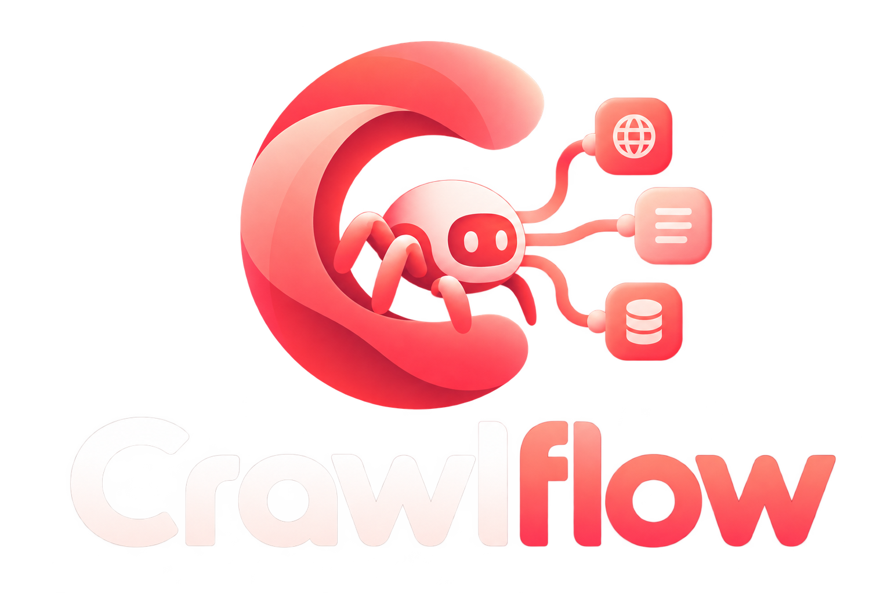
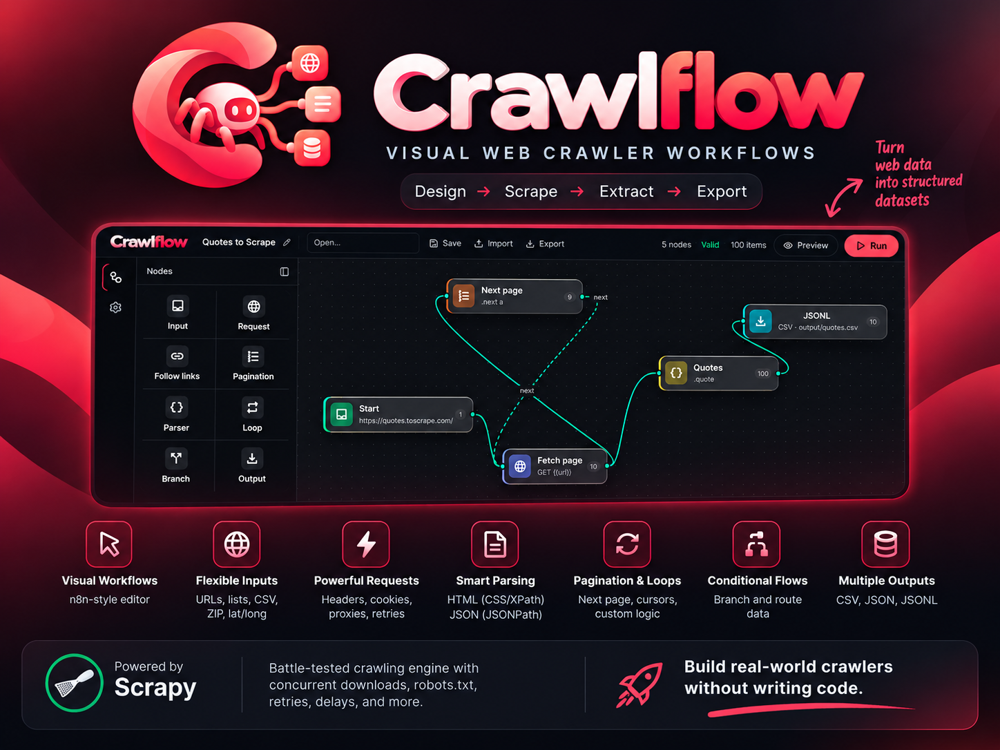

# Crawlflow

<p align="center">
  
</p>

n8n-style **visual crawler workflows**, executed by **Scrapy**.

You draw a graph (Input → Request → Parser → Pagination / Follow / Loop / Branch → Output). Values move along edges as a flat set of variables (`zipcode`, `url`, extracted fields). Crawlflow checks that graph, then runs it as a Scrapy spider: concurrent downloads, robots.txt, cookies, headers, retries, delays, proxies.

<p align="center">
  
</p>

## Node palette

| Node | Role |
| --- | --- |
| **Input** | Seed data: one URL, a list, a CSV table, or a numeric range |
| **Request** | HTTP method, URL, query params, headers, cookies, body, and proxy. Values can be `{{variables}}` |
| **Parser** | HTML (CSS / XPath) or JSON (JSONPath) into named fields |
| **Follow links** | Link extractor (allow/deny regex) |
| **Pagination** | Next link, `?page=` param, JSON cursor, or an incrementing page variable |
| **Loop** | Iterate a list variable |
| **Branch** | Route records true/false (`exists`, `equals`, `contains`, `gt`, `lt`, `regex`) |
| **Output** | JSON / JSONL / CSV |

Global crawl settings (user-agent, default headers and cookies, proxy, concurrency, download delay, robots.txt, retries, timeouts, autothrottle, HTTP cache, depth/page/item caps) map onto Scrapy settings.

## Quick start

```bash
cd ~/Projects/crawlflow
python3 -m venv .venv
source .venv/bin/activate
pip install -e .

crawlflow validate examples/quotes.json
crawlflow run examples/quotes.json -o output/quotes.jsonl
```

Editor + API:

```bash
crawlflow serve          # http://127.0.0.1:8000
cd web && npm install && npm run dev   # http://127.0.0.1:5173
```

`quotes.json` crawls [quotes.toscrape.com](https://quotes.toscrape.com/) (a public scraping sandbox). Honor `robots.txt`, rate limits, and the site’s terms for anything else.

The editor opens `store_locator` by default. That example, and `nearby_json`, call the fake storefront on the API (`/demo/...`), so `crawlflow serve` has to be running before you run them.

## Examples

| File | What it shows |
| --- | --- |
| `examples/quotes.json` | One URL → HTML parser → next-link pagination → JSONL |
| `examples/store_locator.json` | ZIP table → HTML search → follow detail pages → CSV. Needs the API |
| `examples/nearby_json.json` | Lat/long table → JSON API → JSONPath fields → JSONL. Needs the API |

## How it maps to Scrapy

The canvas is a spider program. Every edge carries a context (a dict of variables). Keys starting with `_cf` are internal and are not written to outputs.

1. Input nodes create the starting contexts (`start_requests`).
2. Request nodes become `scrapy.Request` (headers, cookies, method, body, proxy via meta) and pass the context on with the response.
3. Parser nodes emit one new context per record (parent variables plus extracted fields).
4. Follow, Pagination, Loop, and Branch run against that same response or context.
5. Output nodes collect contexts. Files are written when the crawl ends.
6. Pagination and Follow enqueue more Requests (the crawl loop).

Scrapy supplies the crawl loop: Twisted concurrency, middleware, robots, retries, and download settings.

## Workflow JSON

See `examples/quotes.json`. Older graphs that still say `start`, `extract`, or `store` are rewritten to `input`, `parser`, and `output` on load. Edges may set `sourceHandle` (`next`, `true`, `false`) for pagination and branches.

## Layout

```
crawlflow/models/   Workflow schema
crawlflow/engine/   Graph checks, templating, Scrapy spider
crawlflow/api/      FastAPI app, saved workflows, and run orchestration
crawlflow/demo/     Fake storefront used by the bundled examples
crawlflow/cli.py    validate, run, and serve
examples/           Sample graphs
web/                React Flow editor
```
